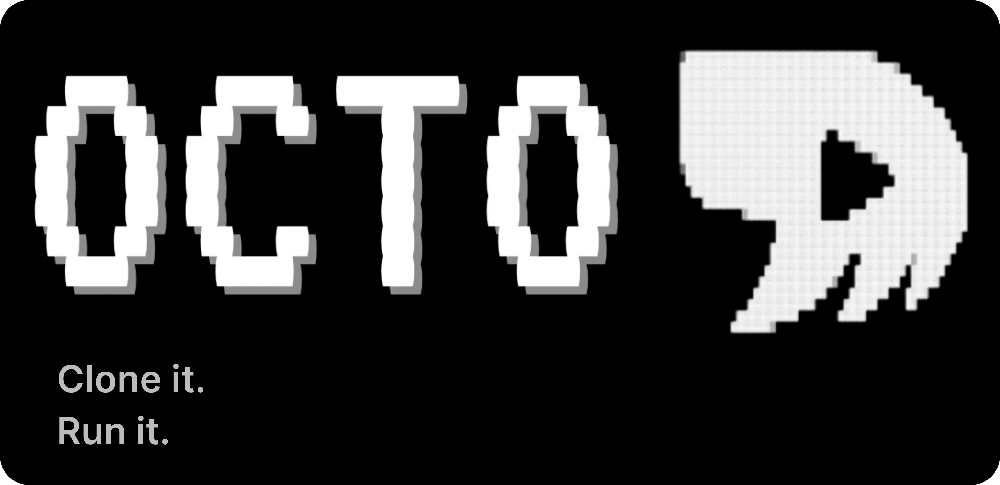

<p align="center">
  
</p>

<p align="center">
  <strong>Make “how do I run this?” disappear.</strong><br>
  Zero-configuration execution intelligence for human developers and autonomous AI agents.
</p>

<p align="center">
  <a href="https://github.com/Octo-sh/Octo-CLI/releases"></a>
  <a href="https://github.com/Octo-sh/homebrew-tap"></a>
  <a href="cmd/octo/mcp.go"></a>
  <a href="https://github.com/Octo-sh/Octo-CLI/releases"></a>
  <a href="https://github.com/Octo-sh/Octo-CLI/releases"></a>
  <a href="https://github.com/Octo-sh/Octo-CLI/releases"></a>
  <a href="LICENSE.md"></a>
</p>

<p align="center">
  <a href="#quick-install">Quick Install</a>
  <span>&nbsp;&nbsp;•&nbsp;&nbsp;</span>
  <a href="#30-second-quickstart">30s Quickstart</a>
  <span>&nbsp;&nbsp;•&nbsp;&nbsp;</span>
  <a href="#ai-agent-companion-octo-mcp">AI Agent Companion</a>
  <span>&nbsp;&nbsp;•&nbsp;&nbsp;</span>
  <a href="#why-octo">Why Octo?</a>
  <span>&nbsp;&nbsp;•&nbsp;&nbsp;</span>
  <a href="#supported-ecosystems--capabilities">Ecosystems</a>
  <span>&nbsp;&nbsp;•&nbsp;&nbsp;</span>
  <a href="#documentation--architecture">Documentation</a>
</p>

---

## Quick Install

```bash
# macOS & Linux via Homebrew
brew tap Octo-sh/tap
brew install octo

# Using Go
go install github.com/Octo-sh/Octo-CLI/cmd/octo@latest
```
*(Precompiled standalone binaries for macOS Apple Silicon/Intel, Linux x86_64/ARM64, and Windows are available on the [Releases page](https://github.com/Octo-sh/Octo-CLI/releases).)*

---

## 30-Second Quickstart

```bash
cd your-project

# 1. Inspect: Discover repository facts, language, framework & package manager
octo inspect   # or: octo ins

# 2. Preview: Inspect port allocations, dependencies & machine changes before running
octo preview   # or: octo prev

# 3. Run: Execute in dependency order, verify runtime health, and teardown cleanly on Ctrl+C
octo run       # or: octo r
```

### Quick Command & Flag Shortcuts

| Quick Command | Full Command | Description |
| :--- | :--- | :--- |
| `octo r` / `octo start` | `octo run` | Analyze, plan, run, and verify the stack |
| `octo ins` / `octo info` | `octo inspect` | Inspect detected languages, frameworks, and signals |
| `octo p` | `octo plan` | Show deterministic execution plan |
| `octo prev` / `octo dry-run` | `octo preview` | Preview machine mutations, ports, and processes |
| `octo v` / `octo check` | `octo verify` | Verify runtime health checks & `.octo.lock` integrity |
| `octo g` / `octo topo` | `octo graph` | Render dependency topology graph |
| `octo e` | `octo env` | Inspect environment variable status |
| `octo e tpl` | `octo env template` | Generate safe `.env` template |
| `octo bench` / `octo eval` | `octo benchmark` | Benchmark against raw shell baselines |

**Everyday Flag Shortcuts:**
- `-j`: Universal shorthand for `--json` across all commands (`octo r -j`, `octo ins -j`, `octo p -j`, etc.).
- `-k` / `--skip-env`: Shorthand for `--skip-env-check` (`octo r -k`).
- `-T`: Shorthand for `--no-tui` (suppress dashboard for standard terminal logs).
- `-N`: Shorthand for `--no-port-shift` (disable automatic port conflict reallocation).
- `-i`: Interactive component selection (`octo r -i`).
- `-s`: Ephemeral container environment (`octo r -s`) or archetype suite (`octo bench -s`). (Note: project env vars pass through).


---

## AI Agent Companion (`octo mcp`)

When AI coding agents (Claude Code, Cursor, Windsurf, Cline) execute code directly through raw bash commands, they waste 40%+ of their context tokens trial-and-erroring missing packages, colliding ports, and orphaning background processes.

Octo includes a native **JSON-RPC 2.0 Model Context Protocol (MCP)** server over stdio. Connect Octo to your favorite AI agent to give it deterministic, zero-hallucination execution capabilities:

### Add to Cursor (`.cursor/mcp.json`):
```json
{
  "mcpServers": {
    "octo": {
      "command": "octo",
      "args": ["mcp"]
    }
  }
}
```

### Add to Claude Code:
```bash
claude mcp add octo -- octo mcp
```

### Available Agent Tools:
- `octo_inspect`: Analyzes the repository to detect language, framework, runtime version, and package manager.
- `octo_plan`: Generates the deterministic dependency-ordered execution plan.
- `octo_preview`: Previews machine changes, required packages, and network port reservations.
- `octo_run_and_verify`: Autonomously executes the stack and verifies runtime health without raw shell guessing.
- `octo_verify`: Validates live services and lockfile fingerprint integrity.

---

## Why Octo?

| Feature | Octo CLI | Raw Shell Scripts | Docker Compose Alone | LLM Bash Agents |
| :--- | :---: | :---: | :---: | :---: |
| **Zero Configuration Required** | ✓ | — | — (requires compose file) | — |
| **Automatic Port Conflict Shifting** | ✓ | — (EADDRINUSE error) | — | — |
| **Backing Service Coordination** | ✓ (Starts DB before app) | — | Partial | — (hangs or fails) |
| **Graceful Teardown on Ctrl+C** | ✓ (Drains process tree) | — (Leaves orphans) | Partial | — (Leaves zombie PIDs) |
| **Zero-Hallucination AI Companion** | ✓ (via MCP) | N/A | N/A | — (hallucinates commands) |
| **Verified Strategy Caching** | ✓ (`.octo.lock`) | — | — | — |

---

## Supported Ecosystems & Capabilities

<p align="center">
  
</p>

- **Languages and Frameworks**: Native evidence detectors for Node.js (Next.js, Express, Vite), Go (Gin, standard library), Python (FastAPI, Django, Flask), Rust (Cargo), Ruby, Java.
- **Port Intelligence**: Detects listening port collisions and automatically rebinds components to free ports via dynamic environment injection (`PORT`).
- **Infrastructure Coordination**: Discovers and boots backing services (PostgreSQL, Redis, MySQL) via Docker Compose before launching application processes.
- **Safe Environment Scoping**: Resolves local environment precedence without ever logging or persisting secrets to planning models or lockfiles.
- **Clean Process Lifecycle**: Traps `SIGINT`/`SIGTERM` to gracefully drain active children and kill zombie daemon PIDs.
- **Strategy Fingerprinting (`.octo.lock`)**: Caches proven startup strategies and only invalidates when code or dependency manifests change.

---

## Documentation & Architecture

Deep-dive documentation and formal specifications live in dedicated guides:

- **[Architecture Deep-Dive](Architecture.md)** — Detailed specification of the canonical execution pipeline, bounded decision engine, topology graph, and runtime adapters.
- **[Vision & Core Principles](docs/VISION.md)** — The foundational philosophy: *Evidence before inference, candidates before decisions*.
- **[Specification Contract](spec/v1/specification.md)** — Formal behavioral contract, candidate schemas, and JSON models.
- **[Benchmark Results](docs/BENCHMARK.md)** — Detection speed and execution startup benchmarks across archetypes.
- **[Project Roadmap](docs/ROADMAP.md)** — Phased milestones, plugin ecosystems, and future adapter targets.
- **[Community & Mentorship](docs/COMMUNITY_AND_MENTORSHIP.md)** — Guidelines for community engagement and contributor onboarding.

---

## Local Development & Testing

```bash
# Clone repository
git clone https://github.com/Octo-sh/Octo-CLI.git
cd Octo-CLI

# Build standalone binary
go build -o bin/octo ./cmd/octo

# Run unit and regression test suite
go test -count=1 ./...

# Run dynamic archetype test suite across real-world repos
./scripts/test-archetypes.sh
```

---

## Contributing

Contributions are welcome! To add a new detector, candidate provider, or runtime adapter, please review [CONTRIBUTING.md](CONTRIBUTING.md) and [Architecture.md](Architecture.md) before opening a PR.

---

## License

MIT License — see [LICENSE.md](LICENSE.md).
